# Swift memory fundamentals

**How to read the drawings.** Sizes assume a 64-bit device, where a **word** is 8 bytes. A **pointer** is a value containing a memory address. **Inline** means “inside the memory already reserved for the variable,” without a separate allocation. In the drawings, `md` means a pointer to type information (**metadata**), and `rc` means the reference-count field.

The drawings show typical memory layouts. The compiler can remove copies, avoid allocations, or keep values in CPU registers. These changes do not change how the code behaves: for example, changing a copied value still leaves the original unchanged. Exact layouts and scheduling can vary with the Swift version, platform, and executor.

## 1. Stack and heap

A running thread has a **stack**. Each ordinary function call uses a **stack frame**: space for that call's temporary data. Returning from the call releases that space. In the simple case, reserving and releasing it just moves the stack pointer. The compiler usually knows how much stack space the call needs. Reserving that space does not require searching for a free heap block. The function cannot use its stack frame after it returns.

The **heap** stores data that can remain after a function returns. For example, a heap object can still exist after the function that created it has finished. To allocate a block, the allocator finds space of the right size, often using lists of available blocks called **free lists**. Threads may need locks when they compete for that space. Freeing a block returns it to the allocator.

Swift uses **Automatic Reference Counting (ARC)** for class objects and many heap buffers. A strong reference keeps an object alive. Adding one is a **retain**; removing one is a **release**. When no strong references remain, the object is destroyed. Section 3 explains when the memory itself can be freed.

Reference counts shared between threads need **atomic updates**: other threads must see the whole update, never a partly completed one. This can cost more than an ordinary read or write.

Moving a stack pointer is usually cheap. Finding heap space needs more work. Updating the same reference count repeatedly from several CPU cores can add more cost because the cores must take turns writing it. Actual costs depend on the operation.

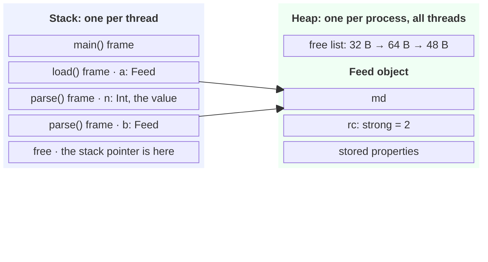

| Step | What happens |
|---|---|
| call `parse()` | Reserve the frame by moving the stack pointer. For this example, its size is known ahead of time. |
| return | The stack pointer moves back. `n` is gone, `b` is released. |
| `malloc` | Ask the allocator for a block that fits. This may involve free lists and locks. |
| `let b = a` | Retain: rc 1 → 2. Atomic. |
| `b` goes away | Release: rc 2 → 1. Atomic in this shared-object example. At 0, destroy the object; the allocation can be freed when no unowned references require it. |

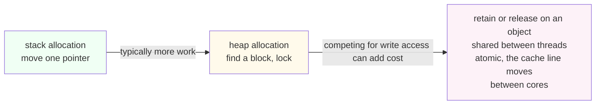

## 2. Values and references

The first question is **what does assignment copy?** The second is **where is it stored?** A value type does not automatically mean “stack.”

### Value types: `struct`, `enum`, and tuple

Copying a value gives you an independent value. Changing the copy does not change the original. For a simple struct, this means copying its stored bytes:

```swift
struct Point {
    var x: Double
    var y: Double
}

let p = Point(x: 1, y: 2)
var q = p
q.x = 9                         // p.x is still 1
```

`Point` occupies 16 bytes in this example. It is stored inline wherever the variable lives:

| Where the `Point` is used | Where its bytes live |
|---|---|
| Local variable in an ordinary function | Typically in that function's stack frame |
| Stored property of a class | Inside the class object's heap block |
| Element of an array | Inside the array's buffer, typically on the heap |

There is no separate allocation for this `Point`. For a specific struct type, such as `Point`, Swift knows how much space its properties need and where to put them. This lets Swift store the struct inside another value. Copying a struct made only of plain values, such as `Int` and `Double`, needs no reference counting. A struct containing a reference or a collection is different; see section 4.

A struct has **type metadata**: information about its type, such as its size and how to copy it. This information is stored separately from the struct values.

For a simple type such as `Point`, the compiler can put the metadata in the executable or a library. It becomes available in memory when the program loads. Swift can also create metadata while the program runs, for example for some generic types.

Each `Point` contains only `x` and `y`; there is no metadata pointer inside its 16 bytes. The compiler knows where those properties are from the declaration. Code that needs this information while running can read the shared metadata. See [Swift's metadata implementation](https://forums.swift.org/t/preparing-metadata-records-for-abi-stability/6975).

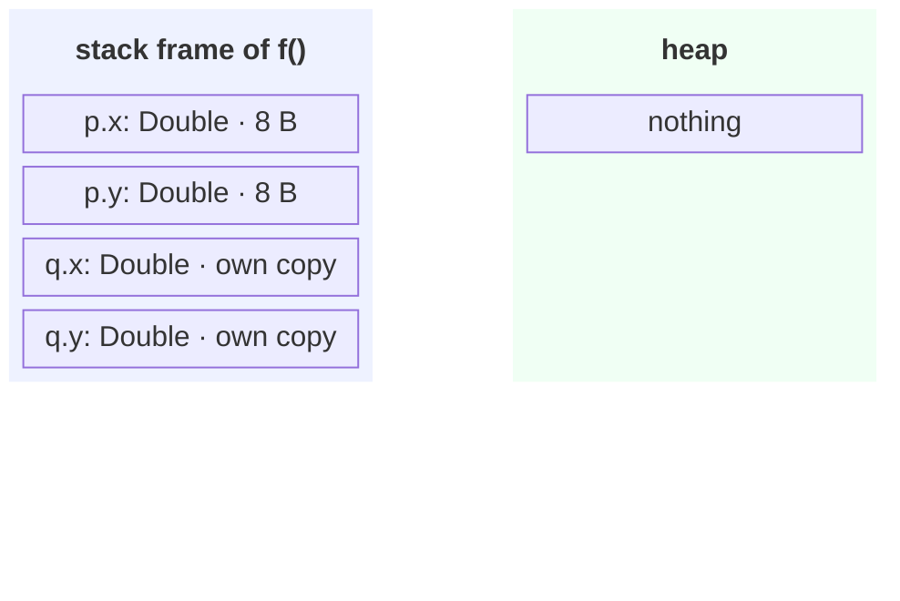

Here `p` and `q` each have their own 16 bytes. Assignment copies the bytes; it creates no heap object and changes no reference count.

### Reference types: `class` and `actor`

A class variable holds a pointer to an object. On a 64-bit device, that pointer is 8 bytes. The object normally lives on the heap.

```swift
final class Feed {
    var count = 0
}

let a = Feed()                  // create an object
let b = a                       // copy its address; keep the same object alive
b.count = 9
print(a.count)                  // 9
```

`a` and `b` refer to the same object. Assignment copies its address and, when needed, retains the object. It does not copy the stored properties.

A native Swift class object begins with a pointer to its type information and a reference-count field. Its stored properties come after those two fields. The type information helps Swift choose which method implementation to call while the program runs (**dynamic dispatch**). It also supports `type(of:)`.

The following drawing uses a `Feed` with `token` and `items` properties. The array header is inside the object; its elements live in a separate buffer.

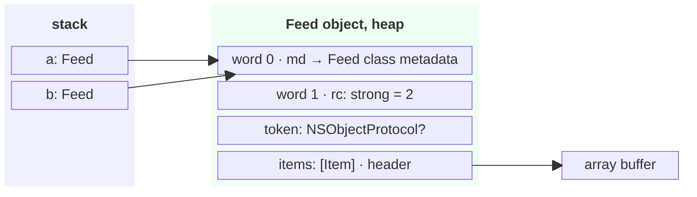

Actors are also reference types. Their extra scheduling data is explained in section 7. Closures can also share captured data; their layout is explained in section 5.

## 3. ARC: how objects stay alive

**A strong reference keeps the object alive.** Swift adds retains when it needs to keep an object alive and releases when a reference is no longer needed. The compiler can remove unnecessary retains and releases, so an assignment in your code does not always cause a retain.

### The object header

For a typical native Swift class on a 64-bit device:

| Offset | What is stored there |
|---|---|
| 0 | Pointer to class metadata: information about the object's type |
| 8 | Reference-count field |
| 16 onward | Stored properties |

The reference-count field stores several things in one 64-bit word: strong-count information, unowned-count information, and flags that record the object's state. Swift uses some count entries internally, so the stored counts do not always equal the number of references visible in your code.

### Strong, unowned, and weak references

| Reference | Keeps the object alive? | What happens after the object is destroyed? |
|---|---|---|
| Strong | Yes | The object stays alive while this reference is needed |
| `unowned` | No | Reading it crashes if the object has been destroyed |
| `weak` | No | Reading it returns `nil` |

When the strong count reaches zero, Swift runs `deinit` and destroys the stored properties. Safe `unowned` references can keep the object's memory reserved after that. Swift frees that memory when the unowned count allows it. The reserved memory does not make the destroyed object usable.

### Why weak references need a side table

A **side table** is a separate small heap block with reference-count information. Creating the first `weak` reference normally allocates this table. Swift moves the strong and unowned counts into the table and adds a weak count. The object's original count field then stores a pointer to that table and a flag indicating that the table is in use.

Weak references point to the table. After the object is gone, the table can still record that it is dead. Reading a weak reference then returns `nil`. The table remains while weak references still need it.

Once an object uses a side table, its retains and releases follow an extra pointer to reach the counts. Swift can also create a side table if a count becomes too large to fit in the object's count field. This rarely happens in ordinary code.

The costs to remember:

- Strong and unowned references need count updates, normally atomic when shared across threads.
- The first weak reference can add an allocation. Later count updates for that object need an extra pointer lookup.
- `unowned` does not itself require a weak side table, so it can be cheaper. It can still refer to an object that already has a side table. The object must still be alive when you read the reference, or the read crashes.

Source: [Swift runtime, RefCount.h](https://github.com/swiftlang/swift/blob/main/stdlib/public/SwiftShims/swift/shims/RefCount.h), including the inline counts and side-table layout.

### Why sharing an object across threads can be expensive

A **CPU cache** keeps recently used memory close to a CPU core. It moves data in blocks called **cache lines**. If several cores update the same reference count, they must take turns getting permission to write its cache line.

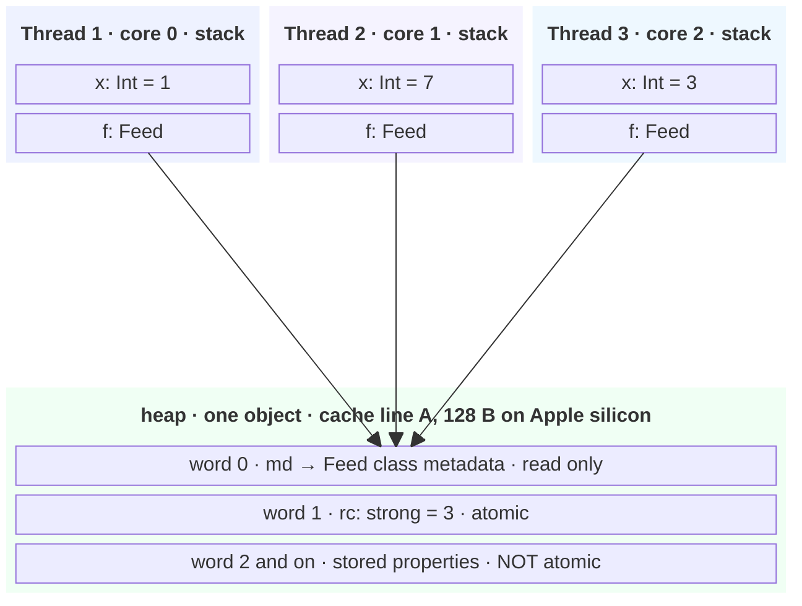

Each thread has its own copy of `x`. Each core's nearest cache, called its **L1 cache**, may hold a copy of cache line A.

Reading the drawing:

- Each thread has its own stack. Values on it (`x`) are separate copies, so threads never see each other's `x`.
- The object exists once. Each thread holds only a pointer to it, and each pointer counts once in `rc`.
- A retain or release updates the count atomically. Only one core can have permission to write the count's cache line at a time. If several cores repeatedly update it, they must pass that permission between them, which can make updates wait. This is why repeatedly retaining the same object on several threads can be costly.
- The header and the first stored properties are on the same cache line. Writing one of those properties can therefore delay a retain on another core, even though the two operations change different fields.
- ARC makes reference-count updates safe; it does not make property access safe. If two threads access `items` at the same time and at least one writes it, without synchronisation, that is a **data race**. Swift 6 concurrency checking helps catch unsafe sharing. You can share data safely by keeping it immutable, using a lock, or protecting it with an actor. `Sendable` tells Swift that a value is safe to pass between tasks or actors. The compiler's checks depend on the code's isolation and settings.

Source: cache line size from `sysctl hw.cachelinesize` on an M-series Mac (128). Header layout from the Swift runtime header `RefCount.h`.

## 4. References inside structs and copy-on-write

### A struct can contain a class reference

```swift
final class User {
    var name: String

    init(name: String) {
        self.name = name
    }
}

struct Row {
    var id: Int
    var owner: User
}

let row = Row(id: 1, owner: User(name: "Alexandra Johnson"))
```

A `Row` uses 16 bytes here: 8 for `id`, 8 for the `owner` pointer. Copying it copies both words and retains the `User`. The two rows have separate `id` values but point to the same owner. Changing that owner's properties is visible through either row.

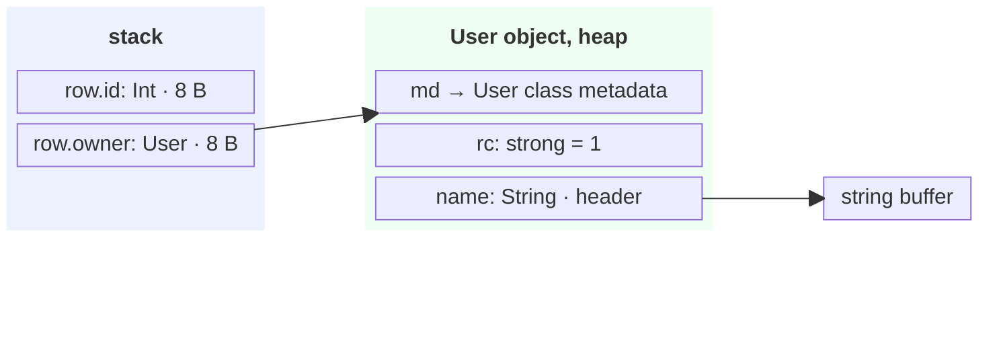

The `String` header for the `name` property is inside the `User` object. The drawing shows `User.name` using a separate buffer; small strings may store their characters in the header instead.

```swift
var copy = row
copy.id = 2
copy.owner.name = "Morgan Smith"

print(row.id, copy.id)             // 1 2: separate stored values
print(row.owner.name)              // Morgan Smith: shared User object
print(row.owner === copy.owner)    // true
```

Copying this row copies only 16 bytes, but it can still need one retain for `owner`. A struct needs retains for each strong reference it copies, unless the compiler can remove them.

### Collections share storage until a copy changes

`Array`, `String`, `Dictionary`, and `Set` are value types that can store their contents in reference-counted heap buffers. The value itself can be small even when its buffer is large. Copying the value can copy a reference to that buffer instead of copying every element immediately.

**Copy-on-write (COW)** means copies can share a buffer until one needs to change it. If the buffer is still shared, the changed value gets its own buffer. This avoids copying data before a change makes the copy necessary.

**Being a value type describes what happens when you copy it, not where its data lives.** Changing the elements of one array or adding an element to one set leaves its copy unchanged. That is **value semantics**. The two collections can still share a heap buffer until one changes.

If a collection contains class references, copying it copies those references. The objects remain shared: changing an object's property is visible through both collections.

```swift
let xs = [1, 2, 3]
var ys = xs                       // share storage for now
ys.append(4)                      // ys needs its own storage
// xs is [1, 2, 3]; ys is [1, 2, 3, 4]
```

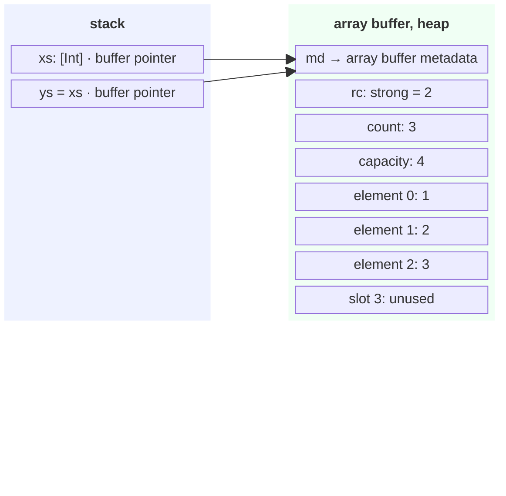

In this example, the buffer has two owners. Before changing `ys`, Swift creates a buffer for it, copies the three elements, then appends `4`. If only one array uses the buffer and it has enough room, Swift can change that buffer directly.

`isKnownUniquelyReferenced` asks whether a class object has a single strong owner. It is useful when implementing your own COW storage. If the object has one strong owner, your COW implementation may be able to change its storage directly. If the storage is shared, it needs a copy before changing it.

The same behavior applies to an array stored inside a struct:

```swift
struct Scores {
    var values: [Int]
}

let original = Scores(values: [1, 2, 3])
var updated = original             // the array can share its buffer
updated.values.append(4)           // mutation separates the array storage
print(original.values)            // [1, 2, 3]
print(updated.values)             // [1, 2, 3, 4]
```

This is why `Scores` can be cheap to pass around. Its copy may retain a buffer, but it does not necessarily copy every element. Collections store their data in different ways. For example, a small string can store its characters without a separate heap buffer.

## 5. Closures: code plus captured data

A closure contains **code to run** and access to **variables it uses from outside the closure**. Using those outside variables is called **capturing** them. A typical Swift closure value uses two words:

| Word | Meaning |
|---|---|
| Function pointer | Address of the compiled code |
| Context pointer | Address of captured data, or `nil` if there is none |

The compiled code is stored in the executable or a library. The **context** stores the data captured by this particular closure.

### Three capture cases

| Case | Where the captured data can live | Typical cost |
|---|---|---|
| No captures, such as `{ $0 * 2 }` or a top-level function | No context needed | Copy two words; no context allocation |
| Captures, non-escaping | The caller's stack frame, because the closure cannot run after the call returns | Can avoid allocating captured data on the heap and retaining it |
| Captures, escaping: stored, returned, or passed to `@escaping` | Captured data stored on the heap and managed with ARC, if it is needed after the call returns | Allocate space for captured data and keep it alive with ARC |

A **non-escaping closure** cannot be stored for use after the function call returns. Its captured data may stay on the stack. An **escaping closure** can be used later, so any data it still needs must remain available. The compiler can sometimes avoid allocations or combine them; an escaping closure does not always allocate exactly one box.

**No captures.** This closure uses only its argument. It needs no data from the surrounding scope:

```swift
let double: (Int) -> Int = { value in
    value * 2
}
print(double(3))                    // 6
```

**Non-escaping capture.** Closure parameters are non-escaping by default. `runNow` calls its closure before returning, so the captured `n` does not need to survive `showNumber()`:

```swift
func runNow(_ action: () -> Void) {
    action()
}

func showNumber() {
    let n = 3
    runNow { print(n) }             // captures the local n
}

showNumber()                       // 3
```

**Escaping capture.** A returned closure can run after the method that created it returns. This example extends the `Feed` class declared in section 2, which has a `count` property:

```swift
extension Feed {
    func makeUpdater() -> () -> Int {
        var n = 0
        return {
            n += 1                 // captured variable survives makeUpdater()
            self.count = n         // captured self keeps this Feed alive
            return self.count
        }
    }
}

let feed = Feed()
let update = feed.makeUpdater()
print(update())                    // 1
print(update())                    // 2
print(feed.count)                  // 2
```

The returned closure keeps access to both `n` and `self`. Its captured data can use heap storage so it remains available after `makeUpdater()` returns. The drawing below shows these three cases; the compiler may store the captured variable in a separate shared box rather than directly inside the closure context.

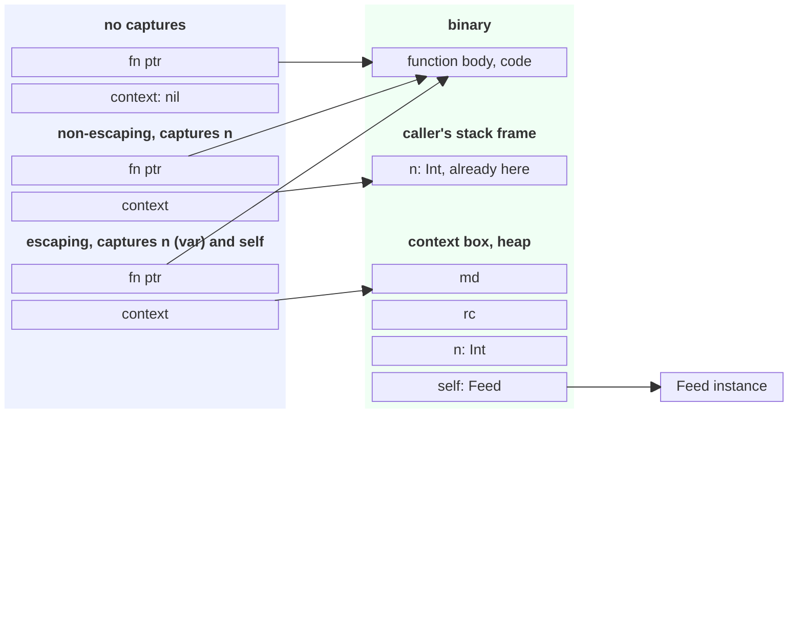

On disk, the closure's machine code is in the executable or a library. When the program runs, the operating system makes that code available in a part of the program's memory called the **text segment** (`__TEXT` on Apple platforms). This memory can be executed and is usually read-only. The operating system loads code pages into physical RAM as needed.

The text segment is separate from the stack and heap. In the drawing, “binary” means this loaded code. The function pointer stores the address of the code to run.

Functions, methods, initializers, deinitializers, property getters and setters, and compiler-generated helpers also store their instructions in this code memory. Their data is stored separately. For example, `Feed.makeUpdater()` has its instructions in the text segment, while `feed.count` is stored inside the heap object.

### What exactly is captured?

- A captured value declared with `let` can be copied into the context. The closure has that value.
- A captured `var` is shared between the closure and the code outside it. If the variable must remain after the call returns, Swift can store it in a heap **box**: a block of memory both can access. Two closures capturing the same variable then see each other's changes.
- A captured class reference is strong by default and keeps the object alive. An object that stores a closure capturing that same object can form a **retain cycle**: each keeps the other alive. `[weak self]` or `[unowned self]` changes the reference stored in the context.

```swift
func makeCounter() -> () -> Int {
    var n = 0                       // shared storage that survives this call
    return { n += 1; return n }     // the closure uses that storage
}
let a = makeCounter()
let b = a                           // same closure, same captured variable
_ = a()
print(b())                          // 2
```

A capture list changes the rule. `{ [x] in ... }` captures the current value of `x` when the closure is created, even if `x` is a `var`. Without the capture list, a closure that refers to that variable shares it. If `x` is a class reference, capturing its current value copies the pointer; it does not clone the object.

```swift
final class User {
    var name: String

    init(name: String) {
        self.name = name
    }
}

var x = User(name: "Alex Johnson")
let capturedValue = { [x] in x.name }
let sharedVariable = { x.name }

x.name = "Morgan Smith"
print(capturedValue())              // Morgan Smith
print(sharedVariable())             // Morgan Smith

x = User(name: "Taylor Davis")
print(capturedValue())              // Morgan Smith: keeps the original object
print(sharedVariable())             // Taylor Davis: reads the current x
```

Both closures initially refer to the same object, so both see changes to its `name` property. Assigning another object to `x` shows the difference: `[x]` keeps the original reference, while the closure without a capture list reads the shared variable's current reference.

## 6. Protocols in memory

Declaring `protocol Shape` creates no storage for a value. The memory cost depends on **how you use the protocol as a type**.

Two terms help here:

- **Metadata** stores information about a specific type, such as its size and how to copy its values. “Concrete type” means a specific type such as `Circle`, rather than a placeholder such as `S`.
- A **witness table** tells Swift which methods a type uses to meet a protocol's requirements. For example, the `Circle: Shape` table identifies the method to call for `Shape.area()`.

**Unspecialised generic code** is one compiled function that works with different types. For example, the same compiled `areaOf<S: Shape>` can accept a `Circle` or a `Polygon`. Swift passes extra arguments that you do not write in your code: the type's metadata and a pointer to its witness table. These tell the function how to handle the value and which `area()` method to call.

**Specialised generic code** is a version compiled for one specific type. A version of `areaOf<S: Shape>` for `Circle` already knows its size, layout, and `area()` method. It may call that method directly, or copy its instructions into the caller (**inline** it), without looking up the method in a witness table. The compiler decides whether to make this version; a generic call does not guarantee specialisation.

```swift
protocol Shape {
    func area() -> Double
}

struct Circle: Shape {
    var radius: Double

    func area() -> Double {
        Double.pi * radius * radius
    }
}

func areaOf<S: Shape>(_ shape: S) -> Double {
    // The shared generic version receives extra type information.
    // It finds the area() method through a witness table.
    shape.area()
}

// This shows what a version compiled for Circle could do.
// The compiler may give its version a different name or structure.
func areaOfCircle(_ shape: Circle) -> Double {
    // The compiler already knows Circle's layout and area() method.
    shape.area()
}

let circle = Circle(radius: 2)
print(areaOf(circle))               // approximately 12.57
print(areaOfCircle(circle))         // approximately 12.57
```

Both calls return the same result. The difference is how the compiled code finds the value's layout and the method to call. `areaOfCircle` shows what a version compiled specifically for `Circle` could look like.

To create that version, the compiler must know the argument's type and be able to read the generic function's body. It must also choose to apply the optimisation, usually in a Release build. **Whole-module optimisation** lets the compiler optimise code across files in the same module. `@inlinable` makes a function's body available to the compiler when another module uses it. The compiler may copy the specialised instructions into the caller instead of creating a separate function.

Other types conforming to `Shape` do not prevent this optimisation. Calls with `Polygon` can get a version for `Polygon`, while calls with `Circle` can get a version for `Circle`. Declaring that a type conforms to `Shape` does not itself create a specialised function. Swift can still use the shared generic version when the type is unknown or the compiler chooses not to specialise. See [Swift's optimisation guidance](https://github.com/swiftlang/swift/blob/main/docs/OptimizationTips.rst) and [generics implementation](https://download.swift.org/docs/assets/generics.pdf).

### Generics and `some Shape`: keep the concrete value

With `<S: Shape>` or `some Shape`, the value keeps its concrete type and layout. It does not need an `any Shape` container.

```swift
protocol Shape {
    func area() -> Double
}

struct Circle: Shape {
    var radius: Double

    func area() -> Double {
        Double.pi * radius * radius
    }
}

func areaOf<S: Shape>(_ shape: S) -> Double {
    shape.area()
}

// In a parameter, some Shape is shorthand for a generic parameter.
func areaOfOpaqueParameter(_ shape: some Shape) -> Double {
    shape.area()
}

// In a return type, some Shape hides one fixed concrete type: Circle here.
func makeShape() -> some Shape {
    Circle(radius: 2)
}

let circle = Circle(radius: 2)
print(areaOf(circle))                  // approximately 12.57
print(areaOfOpaqueParameter(circle))   // approximately 12.57
let opaqueShape = makeShape()
print(opaqueShape.area())              // approximately 12.57
```

`areaOf` accepts any type that conforms to `Shape`. `makeShape` always returns a `Circle`, but its return type tells callers only that the result conforms to `Shape`. Neither needs the extra storage used by `any Shape`, described next.

With `some Shape`, Swift stores the value using its actual type's size and layout. It can read the type metadata when it needs that information while the program runs. Unlike `any Shape`, it does not put the value in a fixed-size, 24-byte buffer. A large value therefore does not need a separate heap box just because it is used as `some Shape`.

Here, `makeShape()` returns an 8-byte `Circle`. This avoids the boxing that `any Shape` may need. It does not guarantee that the value uses no heap memory: its type could be a class, contain an array with a heap buffer, or be stored inside a heap object.

### `any Shape`: store a value with the information needed to use it

An **existential container** lets one variable hold values of different types that conform to a protocol. A typical `any Shape` container on a 64-bit device contains:

| Part | Size | Purpose |
|---|---|---|
| Value buffer | 24 bytes: three words | Hold a small value, or a pointer to a box for a larger value |
| Metadata pointer | 8 bytes | Identify the stored type |
| Witness-table pointer | 8 bytes | Find its `Shape` implementations |
| Total | 40 bytes | The container itself |

The container is stored inline wherever its variable lives: typically on the stack for a local, inside a class object for a property, or inside an array buffer for an element. The value can go inside the buffer if it is small enough and the buffer meets its **alignment** requirement: the memory address must be a suitable multiple for that type. Otherwise, Swift puts the value in a separate heap box managed with ARC.

```swift
protocol Shape {
    func area() -> Double
}

struct Circle: Shape {
    var radius: Double

    func area() -> Double {
        Double.pi * radius * radius
    }
}

struct Point {
    var x: Double
    var y: Double
}

// A triangle is a polygon with three points stored inline.
struct Polygon: Shape {
    var points: (Point, Point, Point)

    func area() -> Double {
        let (a, b, c) = points
        return abs((b.x - a.x) * (c.y - a.y)
                 - (b.y - a.y) * (c.x - a.x)) / 2
    }
}

let circle = Circle(radius: 2)
let polygon = Polygon(points: (
    Point(x: 0, y: 0),
    Point(x: 4, y: 0),
    Point(x: 0, y: 3)
))

var shape: any Shape = circle          // Circle fits in the value buffer
print(shape.area())                   // approximately 12.57
shape = polygon                       // same variable, different concrete type
print(shape.area())                   // 6.0

let shapes: [any Shape] = [circle, polygon]
print(shapes.map { $0.area() })        // approximately [12.57, 6.0]

// Sizes in bytes on a 64-bit device:
print(MemoryLayout<Circle>.size)       // 8
print(MemoryLayout<Polygon>.size)      // 48
print(MemoryLayout<any Shape>.size)    // 40
```

The tuple stores three `Point` values inside `Polygon`, each containing two 8-byte `Double` values. This makes the example's `Polygon` 48 bytes, larger than the existential's 24-byte value buffer. The following drawing shows containers holding the two example values.

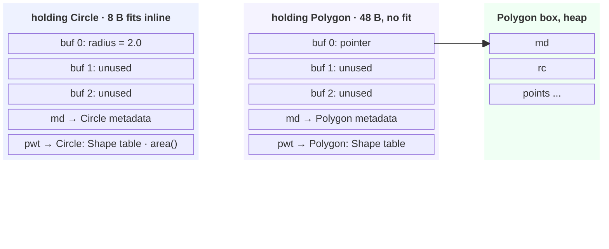

**pwt — Protocol Witness Table.** In the drawing, `pwt` is a pointer to the table of methods a type uses for `Shape`. For example, `Circle: Shape` tells Swift which method to call for `area()` on a `Circle`.

Both containers use 40 bytes. The `Circle` fits inside its container. The 48-byte `Polygon` needs a separate box; storing it adds an allocation, and copying its container may retain that box. For a stored value type with value semantics, changing one copy still leaves the other unchanged.

### Class-only protocols: a smaller container

`protocol Shape: AnyObject` restricts `Shape` to reference types. `any Shape & AnyObject` adds the same restriction when using the protocol as a type.

The container usually needs only two words: a pointer to the object and a pointer to its `Shape` witness table. Swift can find the type metadata through the object's header, so the container needs no separate metadata pointer or three-word value buffer.

The witness table is still needed to find methods such as `area()`. A class can conform to several protocols, each with its own table. Storing the `Shape` table pointer lets Swift find the method without first searching for that table through the object's type information.

```swift
protocol Shape: AnyObject {
    func area() -> Double
}

final class Circle: Shape {
    var radius: Double

    init(radius: Double) {
        self.radius = radius
    }

    func area() -> Double {
        Double.pi * radius * radius
    }
}

let circle = Circle(radius: 2)
let shape: any Shape = circle
let copy = shape                       // another reference to the same object
circle.radius = 3
print(shape.area())                   // approximately 28.27
print(copy.area())                    // approximately 28.27
print(shape === copy)                 // true
print(MemoryLayout<any Shape>.size)   // 16 on a 64-bit device
```

This example uses a class-only `Shape` declaration. The 16-byte container holds a reference to the `Circle` object and its witness table; the object has its own heap allocation. Copying the container gives you another reference to the same object.

### What this means when choosing a design

Declaring a protocol does not make each value larger. Storing a value as `any Shape` can require a container and, for a value that does not fit, a heap box. Calling `area()` can require an **indirect call**: looking up the function's address in a table before calling it. Generics do not need this container. Specialisation may also let Swift call the method directly.

### Summary: choosing `some` or `any` for a parameter

- Use `some Shape` when a method needs to process a value that conforms to `Shape`. It is shorthand for `<S: Shape>`: each call can use a different type. Swift keeps that type's layout and may specialise the method for it. No `any Shape` container is needed, but this alone does not guarantee faster code or zero allocations.
- Use `any Shape` for a property or collection that must hold different types conforming to `Shape`, such as `[any Shape]`. The container records which type is stored, but code using it works through the protocol. A generic method can also put its argument into an `any Shape` property; its parameter does not need to use `any`.
- Use a named generic parameter when two arguments must have the same type. `func compare<S: Shape>(_ first: S, _ second: S)` requires both arguments to have the same concrete type. Two separate `some Shape` parameters allow different types.

Use `some` for processing a value that conforms to a protocol, and `any` for storage that accepts different types. In a return type, `some Shape` means the function returns one fixed type chosen by the function's author, while callers know only that it conforms to `Shape`. See [WWDC22: Embrace Swift generics](https://developer.apple.com/videos/play/wwdc2022/110352/) and [SE-0341: Opaque parameter declarations](https://github.com/swiftlang/swift-evolution/blob/main/proposals/0341-opaque-parameters.md).

The 40-byte drawing shows a container for one protocol without a class-only restriction. Other protocol combinations can have different layouts.

## 7. Actors and tasks

### 7.1. The whole picture: state, work, and a thread

An actor is a reference type that protects its stored properties. Several tasks can use the same actor, but only one can run code that accesses its protected data at a time. This rule is called **actor isolation**. Code that follows the rule and can access that data is called **actor-isolated code**.

A **task** executes code, including async function calls. If it suspends at an `await`, it saves what it needs to continue later. A **thread** runs the task's instructions while the task is executing. The actor protects its data, the task records what to do next, and the thread executes the code.

A **default actor** is an ordinary type declared with `actor` that uses Swift's built-in executor. It has no dedicated thread or stack. Its code can run on different threads from the shared thread pool at different times. When a task must wait for access, it can suspend: its execution pauses and the thread becomes available for other work. Its saved data survives until it resumes.

| Part | Responsibility | What survives a wait? |
|---|---|---|
| Actor | Protect shared state | The actor object and its stored properties |
| Task | Execute code and save what is needed to continue | Task storage and saved data |
| Thread | Execute the current piece of code | The task does not need this thread's stack to resume |

The earlier memory rules still apply. Copying an actor reference points to the same object, just like copying a class reference. ARC keeps the object alive. A task's saved data can remain after a stack frame is gone, like the variables used by an escaping closure.

The actor runs one piece of isolated code at a time, but it does not reserve access for an entire async method while that method is waiting. If an actor method suspends, another task may run on that actor before the first method resumes. This is **reentrancy**: actor state can change across an `await`. A synchronous actor method has no suspension point in its body. See [SE-0306: Actors](https://github.com/swiftlang/swift-evolution/blob/main/proposals/0306-actors.md).

### 7.2. One example to follow through the section

`Counter` owns `value`. Each task asks the same actor to increment it, then continues with the result. Calling from outside the actor requires `await` even though `increment()` itself is synchronous: getting access to the actor may require waiting.

```swift
actor Counter {
    private var value = 0

    func increment() -> Int {        // not async: runs to the end without stopping
        value += 1
        return value
    }
}

// These closures have no actor isolation and use the global executor.
nonisolated func sequence1(c: Counter) {
    Task {                           // Task 1
        let label = "1"              // must remain available after the await
        let n = await c.increment()  // hop onto the actor, call, hop back
        print(label, n)
    }
}

nonisolated func sequence2(c: Counter) {
    Task { await c.increment() }     // Assume Task 1 reaches the actor first
    Task {                           // Assume Task 2 arrives while the actor is busy
        let label = "2"
        let n = await c.increment()
        print(label, n)
    }
}
```

For `await c.increment()`, follow three steps:

1. Get access to `c` so the task can run its isolated method.
2. Run `increment()`. Its synchronous body finishes without suspension.
3. Switch back to the caller's executor and continue after the `await`.

Swift's **runtime** is the code that manages tasks, memory, and scheduling while your program runs. An **executor** arranges for pieces of a task's code, called **jobs**, to run. An actor uses a **serial executor**, which runs its jobs one at a time. The global executor runs work on shared pool threads.

A **thread pool** is a group of reusable worker threads. A worker runs a job, then takes more work. When a task suspends at `await`, the worker can run another task instead of waiting. Swift does not create a separate thread for each task, and a suspended task can resume on a different worker.

On Apple platforms, Swift executors use **Grand Central Dispatch (GCD)**, also called **Dispatch**, underneath: the main actor uses the main dispatch queue, and the global executor uses a cooperative thread pool backed by Dispatch. A default actor manages its own waiting jobs and makes sure only one runs at a time, but it does not get a separate GCD queue or dedicated thread. An executor is Swift's way to control where jobs run; a custom executor can use a Dispatch queue, a dedicated thread, or another scheduling system. See [WWDC21: Swift concurrency: Behind the scenes](https://developer.apple.com/videos/play/wwdc2021/10254/) and [SE-0392: Custom actor executors](https://github.com/swiftlang/swift-evolution/blob/main/proposals/0392-custom-actor-executors.md).

Switching to the executor required by the next piece of code is an **executor switch**, also called a **hop**. The same thread may continue running the task after a hop. Likewise, `await` means the task may pause; it does not mean it must pause.

The next two drawings follow this same call. For the busy case, assume Task 1 reaches the actor first and Task 2 arrives while Task 1 is inside `increment()`. Task creation order does not guarantee this schedule.

### 7.3. Actor idle: the call can continue immediately

If the runtime can give the current thread access to the idle actor, it runs `increment()` there and then continues the caller. This is one possible execution:

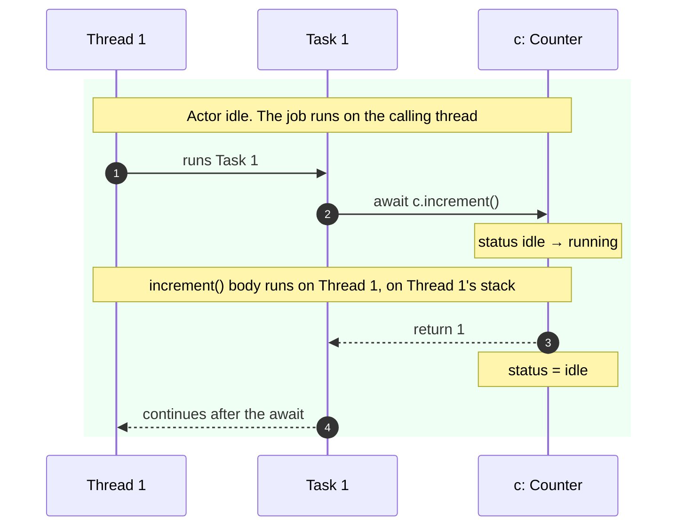

Task 1 stays on Thread 1 throughout. Running on the actor gives the task access to the actor's data; it does not require another thread. The runtime checks that the actor is available and records which thread is running it. The exact checks and updates can differ between runtime versions.

### 7.4. Actor busy: the task waits, the thread is released

Task 2 cannot enter while Task 1 is running isolated code. The runtime queues Task 2's next piece of work and saves where to resume it. Thread 2 is then free to do other work. Once the actor becomes available, a pool thread can run the waiting work.

The drawing chooses Thread 1 to resume Task 2 and shows a separate job that processes the actor's waiting work. These are scheduling choices for this example; another pool thread could take that job.

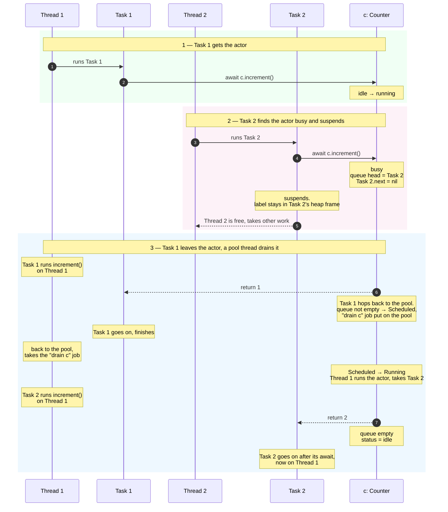

Task 2 is still the same task after resuming on Thread 1. It did not create a new task for `increment()`. It reads its saved data when it resumes; it does not need Thread 2's old stack frame. Neither the actor nor task creation order guarantees which waiting task or thread runs next.

### 7.5. Task memory layout: where saved data lives

The example separates three kinds of data:

- `value` belongs to the actor object and stays there between calls.
- `label` belongs to the task closure and is used after `await`. Its value must remain available if the task suspends. Swift usually stores data needed after suspension in a heap **async frame**: memory the task uses to save its calls and local variables. The compiler can avoid storing a constant such as `"2"` if it can use that constant directly later.
- `increment()` is synchronous. Its temporary data can use the executing thread's stack, registers, or be optimised away. If it were async and suspended, its saved call data would also belong to the calling task.

Starting a task with `Task { }` creates a runtime task object on the heap. Child tasks from task groups and `async let` also need task storage; the runtime can allocate that storage differently. A task object contains both the fields used to schedule it and the fields used to save its progress.

The drawing shows a simplified layout. The pink fields form the **job header**, which is part of the task object. The blue fields are task-specific data. Exact offsets and some other fields are omitted.

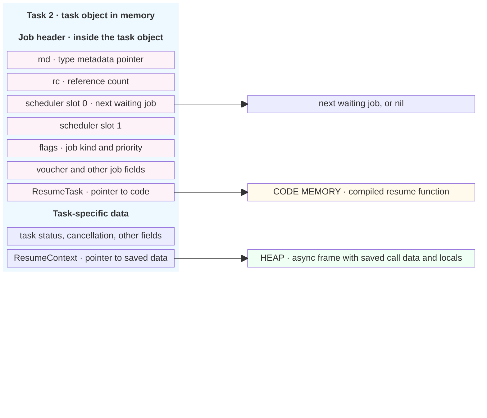

- **`ResumeTask` points to code:** the compiled function that continues the task. Despite its name, it does not point to another task. Its machine code lives in the code memory described in section 5.
- **`ResumeContext` points to data:** the async frame containing saved call data and local variables needed to continue. The frame can be in a separate heap block; it does not have to be inside the task object.
- **The `next` field links waiting jobs:** while the task is queued, the executor can use a scheduler slot to point to the next job. This pointer is separate from the two resume pointers.

To resume execution, the runtime calls the function at `ResumeTask` and passes it `ResumeContext`. The function reads the saved data and continues the task's code.

A **task** is the whole ongoing operation. A **job** is work an executor can schedule. The task object itself contains the job header, so resuming another piece of the task does not require a new task or a separate job object for every piece. Some jobs are separate objects with no task data: the actor's processing job, explained in 7.9, is one example.

Source: [Swift runtime: Task.h](https://github.com/swiftlang/swift/blob/main/include/swift/ABI/Task.h), `Job` and `AsyncTask`. This is a simplified runtime layout, not a fixed layout promised by Swift.

The `Task<Success, Failure>` handle in Swift is a small struct holding an internal reference to the runtime task object. Copies keep that object alive. The runtime also keeps a running task alive until completion. Letting the handle go out of scope does not cancel the task. Swift can free the task object after the task finishes and no references need it.

### 7.6. `@MainActor`: shared isolation for ordinary values

On Apple platforms, `MainActor` runs its isolated code on the main thread. Adding `@MainActor` to a struct or class does not change its usual memory layout. It makes the type's isolated code run on the shared main actor.

```swift
@MainActor
final class ViewModel {
    var count = 0

    func increment() {
        count += 1
    }
}
```

Two `ViewModel` instances have separate `count` properties, but both run their isolated methods on the main actor. Neither gets its own actor queue. `MainActor.shared` is the actor instance; the main executor handles scheduling. Other global actors work the same way: types marked with that global actor share its executor; their values do not become actor objects.

### 7.7. Runtime details: inside the actor object

The rest of this section explains the default-actor implementation recorded from Swift's `main` branch on 2026-10-05. These fields, sizes, queue rules, and scheduling steps describe this runtime version. Swift does not promise that every version uses them. Other versions, configurations, and custom executors can differ.

Like a class instance, `c` is a heap object with metadata and reference-count information. Before its stored `value`, this recorded layout adds a hidden scheduling field of 12 words: 96 bytes on a 64-bit device. That field records whether the actor is available and where waiting jobs are linked.

In the drawing, `c` is shown as a local reference on a stack. In our task closures, the reference can instead be held in captured or saved task storage; either location points to the same actor object. “List 1” and “list 2” are the incoming and prioritised waiting lists, drawn in the next subsection.

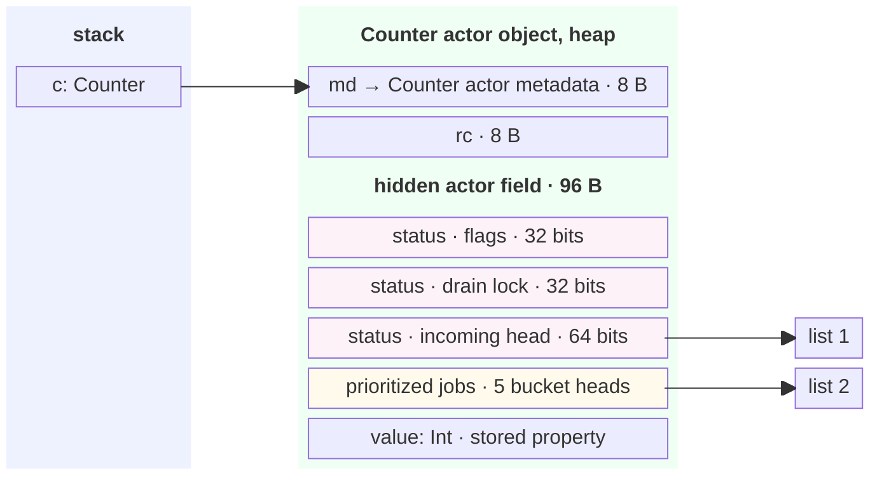

The three pink fields together form a 16-byte status. The runtime updates all three in one atomic operation. The flags record the state, highest waiting priority, and whether priority has been raised (**escalated**). Alongside Idle, Scheduled, and Running, the implementation has a Zombie state used while destroying the actor. The yellow priority-list storage is used only by the thread currently running the actor.

These queue fields are used by default actors. An actor can provide a different executor by implementing the `unownedExecutor` property. Its isolated code then runs on that executor. `MainActor` uses the main dispatch queue. A custom executor can use a serial Dispatch queue, a dedicated thread, or an event loop; a serial queue by itself does not guarantee the same thread. See [SE-0392: Custom actor executors](https://github.com/swiftlang/swift-evolution/blob/main/proposals/0392-custom-actor-executors.md).

### 7.8. Waiting jobs: the actor points to a list of tasks

The task drawing showed a field used as `next`: a pointer to the next waiting job. The actor stores a pointer to the first job, called the list's **head**. Each job points to the next, and the last job points to `nil`. Together these pointers form a **linked list**. The existing jobs supply the links, so queueing a task needs no new queue node. The links do not keep tasks alive; the runtime manages that separately.

New jobs go into an **incoming list**. The thread running the actor moves them into separate lists grouped by priority before choosing what to run. Each priority group is called a **bucket**. Task A through Task F below show how several waiting jobs are linked. They are separate examples from Task 1 and Task 2.

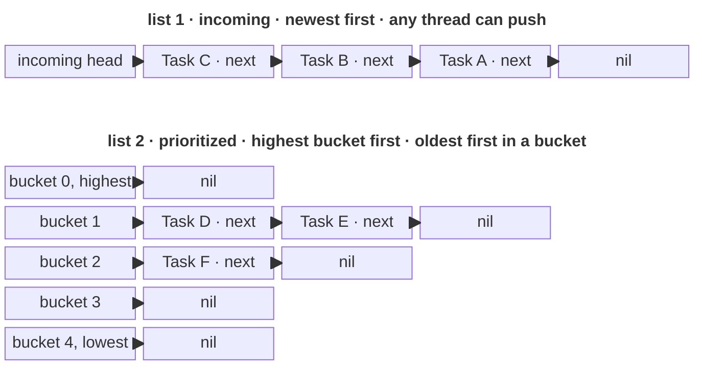

In list 1, Task C arrived last and Task A first.

#### Push: add a waiting task

A **compare-and-swap** operation replaces a value only if it still equals the value the thread read. If another thread changed it first, the operation fails and the caller can retry.

The calling thread updates the actor's 16-byte status with a compare-and-swap loop:

1. Read the actor's status.
2. Point `task.next` to the first job currently in the incoming list.
3. Prepare an updated status that points to this task as the new first job. If the actor was Idle, change it to Scheduled and record the task's priority. If the task has a higher priority than any waiting job, record that new highest priority and set the flag that marks the increase.
4. Store the updated status only if the original status has not changed since step 1. If another thread changed it, retry.

The first-job pointer, state, and priority change together. Another thread therefore cannot read a new pointer with the old state. Adding this link uses an atomic update without taking a separate lock. It allocates no queue node. Scheduling a job to process the actor can still allocate memory, as explained in 7.9.

#### Drain: take waiting work and run it

The thread running the actor:

1. Takes the whole incoming list by atomically setting the actor's first-job pointer to `nil`.
2. Reverses that list so earlier arrivals come first.
3. Adds each job to the end of its priority bucket's list.
4. Runs a job from the highest-priority group that has waiting jobs, then repeats.

When both lists are empty, the actor becomes **Idle**.

When a task leaves this actor to continue on the thread pool or another default actor, it may keep running on the same thread. That thread first releases access to this actor.

If this actor has no waiting jobs, it becomes **Idle**. If jobs are waiting, it becomes **Scheduled**, and the runtime schedules a processing job to run them.

The priority lists described here are how this runtime version works. Swift does not promise that actor jobs run in the order they arrive.

#### Why the same `next` field can serve different queues

The job header has two fields that the executor can use while the job is in its queue. These are called **scheduler slots**. A default actor uses slot 0 for `next`. When the task waits on the global executor instead, Dispatch can use that same field as its own queue link. The task waits in one scheduling queue at a time, so the two executors do not use the field at the same time.

The **same field is reused** depending on which queue the task is waiting in. The drawings show two different moments, not two queues holding Task A at once.

```text
1. Task A waits in an actor's queue

Actor's head
     │
     ▼
┌─────────────────────┐       ┌───────────────┐
│ Task A              │       │ Task B        │
│ scheduler slot 0 ───┼──────►│ ...           │
│ scheduler slot 1    │       └───────────────┘
└─────────────────────┘
  Actor uses slot 0 as “next”.


2. Later, Task A waits in Dispatch's queue

Dispatch's head
     │
     ▼
┌─────────────────────┐       ┌───────────────┐
│ Same Task A         │       │ Another job   │
│ scheduler slot 0 ───┼──────►│ ...           │
│ scheduler slot 1    │       └───────────────┘
└─────────────────────┘
  Dispatch uses slot 0 as its own “next”.
```

Task A is removed from one queue before entering the other. Its old link is no longer needed, so the next executor can overwrite that field.

**Two slots means two available fields—not that the task waits in two queues at once.**

### 7.9. Which thread can run the actor?

The lists hold waiting jobs. The actor's state records whether a thread currently has permission to run its jobs, one at a time. That thread is called the actor's **owner**:

| State | Meaning |
|---|---|
| Idle | No thread is running the actor's code; no work needs processing |
| Running | One thread owns the actor and can take jobs from its queue |
| Scheduled | Jobs are waiting, and a processing job has been scheduled; no thread owns the actor yet |

The **drain loop** takes a waiting job and calls its saved resume function with its saved frame. It repeats while jobs are waiting and the thread is allowed to keep running the actor. It stops when the queue empties, when an executor switch gives up the actor, or when the runtime asks the thread to **yield**: let other work run. Darwin, the operating system underlying Apple platforms, uses this yielding check.

On Apple platforms, the global executor uses a shared thread pool provided through Dispatch. This pool is **cooperative**: tasks suspend to let threads run other work instead of blocking while they wait. Think roughly one worker thread per CPU core, rather than a new thread for every task. The exact number can vary. A worker runs work until it finishes or suspends, then takes more work. Suspending a task does not block the worker while that task waits. Blocking synchronous code can still block a worker.

#### Scheduling a thread to process the actor

The calling thread cannot always run an idle actor immediately. For example, the main thread must stay with the main executor, or the runtime may ask a pool thread to yield. The task is queued instead, and the actor becomes Scheduled. The same state change happens when a thread leaves a Running actor with jobs still waiting.

In this implementation, the runtime creates a small `ProcessOutOfLineJob`. It stores the actor's address and tells a pool thread to get access to that actor and run its waiting jobs. That job goes onto the global pool. A pool thread that takes the job becomes the thread allowed to run the actor. It changes the state from Scheduled to Running.

Linking an existing task into the queue needs no new memory for a queue node. Creating the separate processing job can allocate memory.

#### Why priority affects the running thread

A high-priority task can be waiting behind a lower-priority task already running on the actor. This is **priority inversion**: important work is delayed by less important work.

The actor records the highest waiting priority. On Darwin, its **drain lock** records which thread is running the actor. The runtime can raise that thread's priority until it leaves the actor, helping it finish the work that is delaying the waiting task.

#### Why the lists are kept away from the status

Many threads can update the incoming-list status. Only the actor's current running thread uses the priority lists and stored properties. The runtime puts the priority lists at the end of the hidden actor field, away from the status. This makes it less likely that threads updating the status and threads using the lists need to write the same cache line.

**False sharing** happens when cores write different fields that happen to be on the same cache line. They must still take turns getting permission to write that line. Putting frequently updated fields farther apart can avoid this extra waiting. The runtime source gives this as the reason for the layout.

### 7.10. From saved progress to a runtime call

The task stores two pointers needed to resume. The field names and their types are different things:

| Task field | Pointer type | What it points to |
|---|---|---|
| `ResumeContext` | `AsyncContext *` | The saved async frame containing data needed to continue |
| `ResumeTask` | `TaskContinuationFunction *` | The compiled function that continues execution |

`AsyncContext` is the type used for the saved frame. `TaskContinuationFunction` is a function type used for code that resumes a task. The `*` means a pointer: an address of data or code, rather than the data or code itself.

The compiler turns the next piece of async code into a separate function. For an async function named `foo()`, these generated functions can have names ending in `TY1_`, `TY2_`, and so on.

When switching executors, the compiler passes the next frame and function addresses to `swift_task_switch`. Its parameters use different names from the task fields. This simplified signature shows the connection:

```c
void swift_task_switch(
    AsyncContext *resumeContext,                 // frame pointer
    TaskContinuationFunction *resumeFunction,    // function pointer
    ExecutorRef newExecutor);                   // executor to continue on
```

If the task must wait, the runtime saves those two arguments in the task fields. In simplified pseudocode:

```text
task.ResumeContext = resumeContext
task.ResumeTask    = resumeFunction
```

So `resumeFunction` and `ResumeTask` refer to the same function pointer at this point: one is the parameter name, the other is the field where the runtime saves it. The same applies to `resumeContext` and `ResumeContext`.

Later, the runtime resumes the task by calling the saved function with the saved frame:

```text
task.ResumeTask(task.ResumeContext)
```

The function reads the saved data from the frame and continues execution. This is an **indirect function call** because the runtime finds the function through a pointer.

#### How `swift_task_switch` chooses what to do

The runtime receives the saved data, the function to run next, and the executor that should run it. It checks these cases in order:

1. **The task is already on the required executor.** Run the next piece on the same thread. This switch needs no suspension or saved resume pointers. For example, a synchronous call from one main-actor method to another needs no hop.
2. **The same thread can run the next piece immediately.** This can happen when switching to the global pool or an idle default actor, if the thread may leave its current executor. Pool threads and threads running a default actor can sometimes do this. The runtime cannot assume the main thread or a custom executor's thread may do the same. To start running an idle actor, it atomically changes the state from Idle to Running. Switching to the pool does not require getting access to an actor.

   If the thread releases the actor it was running, that actor becomes **Idle** when no jobs are waiting—even if a task is suspended midway through one of its methods. If jobs are waiting, the actor becomes **Scheduled**, and the runtime schedules a processing job. When a thread takes that job and gets access to the actor, the actor becomes **Running**.

   Suspension alone does not decide the actor's state. In the immediate switch described in point 2, the thread releases the old actor and continues the task elsewhere. If the task instead suspends as in point 3, the thread may keep ownership of the old actor and run another waiting job on it. In that case, the actor stays **Running**. A suspended task alone does not make the actor Scheduled; there must be work ready to run.

3. **The task must wait.** Save the frame pointer and the address of the next function in the task, add the task to the required executor's queue, and return. That executor runs it later. For a busy default actor, the thread already running its queue can pick up the task. For an idle default actor, a pool thread must pick up the processing job. For the main actor, the main dispatch queue runs it. The current thread can run other work on its existing executor.

Examples with `actor Counter` and `c.increment()`:

| The code is on | Calls | Branch | What happens |
|---|---|---|---|
| the main actor | another `@MainActor` method | 1 | plain call on the main thread |
| a pool thread, no actor | `c.increment()`, `c` idle | 2 | this thread takes `c`, runs `increment()`, releases `c` |
| a pool thread, no actor | `c.increment()`, `c` busy | 3 | task queued on `c`, thread back to the pool |
| the main actor | `c.increment()`, `c` idle | 3 | task queued on `c`, `c` scheduled on the pool; the main thread continues |
| inside `c` | a `@MainActor` method | 3 | task queued on the main actor; this thread continues running other jobs waiting on `c` |
| inside `c` | a `nonisolated async` function | 2, switch to the pool under the older rules | this thread gives up access to `c` and keeps running the task. In Swift 6.2 with `NonisolatedNonsendingByDefault` enabled, the call instead keeps running on `c`, unless the function is marked `@concurrent` |

Switching back to the original executor uses the same three checks.

Source: `include/swift/ABI/Task.h` (`AsyncTask::ResumeContext`, `ResumeTask`); `swift_task_switch` and `DefaultActorImpl` in `stdlib/public/Concurrency/Actor.cpp`; WWDC21 "Swift concurrency: Behind the scenes" — https://developer.apple.com/videos/play/wwdc2021/10254/

### 7.11. The busy call again, with the runtime steps filled in

Now the earlier busy-actor sequence can use the fields and states just introduced. “Piece 1” runs before entering the actor, “piece 2” calls `increment()`, and “piece 3” continues afterward. The saved frame and next-function address tell the runtime which piece to run.

```swift
actor Counter {
    private var value = 0

    func increment() -> Int {
        value += 1
        return value
    }
}

nonisolated func sequence2(c: Counter) {
    Task { await c.increment() }     // Task 1: assume it reaches c first

    Task {                           // Task 2: assume it reaches c while busy
        let label = "2"              // Piece 1: before entering c
        let n = await c.increment()  // Piece 2: run increment() on c
        print(label, n)              // Piece 3: back on the global executor
    }
}
```

The piece labels describe the execution steps in the diagram, not separate tasks or an exact compiler-generated split. The assumed arrival order is one possible schedule; creating Task 1 first does not guarantee it reaches `c` first.

Task 1 releases the actor and continues on Thread 1. Because Task 2 is waiting, the runtime schedules a processing job for `c`. A pool thread takes that job and resumes Task 2. Task 1 does not call or resume Task 2 itself. This drawing uses Thread 1 again, but another available pool thread could take the processing job.

The actor object and its stored `value` property live on the heap. `increment()` is a synchronous method, so its call can use the executing thread's stack, like an ordinary function call. Its temporary values can also use registers or be optimised away. This call is separate from the task's heap async frame, which saves data needed across suspension. The actor has no stack of its own.

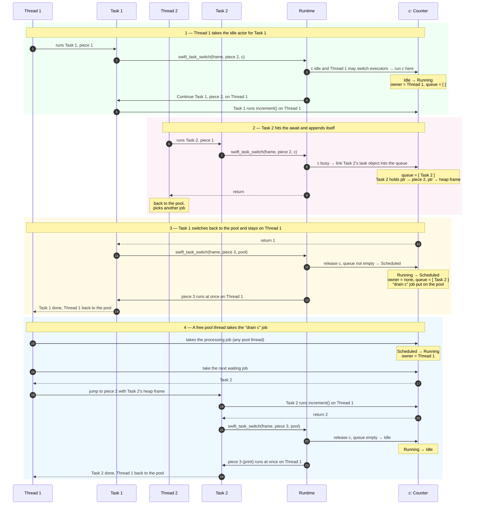

Source: Swift runtime, `stdlib/public/Concurrency/Actor.cpp` (`ActiveActorStatus`, `DefaultActorImpl::enqueue`, `handleUnprioritizedJobs`, `DefaultActorImplFooter`), `include/swift/ABI/Task.h` (`Job::SchedulerPrivate`), `include/swift/ABI/MetadataValues.h` (`NumWords_DefaultActor = 12`, `PriorityBucketCount = 5`). Read on 2026-10-05 from the `main` branch. These are runtime internals, not API, and can change between Swift versions.

## Sources

- [WWDC16: Understanding Swift Performance](https://developer.apple.com/videos/play/wwdc2016/416/)
- [The Swift Programming Language: Structures and Classes](https://docs.swift.org/swift-book/documentation/the-swift-programming-language/classesandstructures/)
- [The Swift Programming Language: Automatic Reference Counting](https://docs.swift.org/swift-book/documentation/the-swift-programming-language/automaticreferencecounting/)
- [Swift runtime: RefCount.h](https://github.com/swiftlang/swift/blob/main/stdlib/public/SwiftShims/swift/shims/RefCount.h), for inline and side-table reference counts
- [WWDC21: Swift concurrency: Behind the scenes](https://developer.apple.com/videos/play/wwdc2021/10254/)
- [Swift runtime: Actor.cpp](https://github.com/swiftlang/swift/blob/main/stdlib/public/Concurrency/Actor.cpp), for default-actor scheduling
- [Swift ABI: Task.h](https://github.com/swiftlang/swift/blob/main/include/swift/ABI/Task.h), for job headers and task resume fields
- [Swift ABI: MetadataValues.h](https://github.com/swiftlang/swift/blob/main/include/swift/ABI/MetadataValues.h), for the recorded actor field size and priority bucket count
